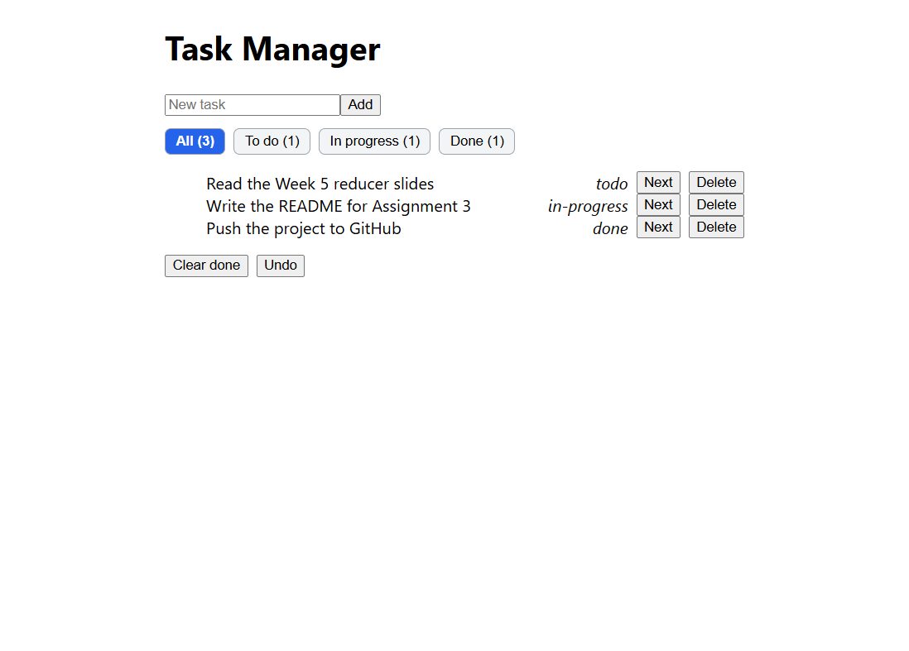

# Assignment 3: Task Manager with a Reducer

**İrem Balkuv** · Student number **2200004679**
SEN0415 Advanced Web Programming, Fall 2026, Week 5

A Vite + React + TypeScript Task Manager. All state lives in `App` in one `useReducer`
and goes down to the components as props (no Context, no state library).

```
npm install
npm run dev      # open the address it prints (http://localhost:5173)
npm run build    # strict type check + production build
npm test         # Vitest (Bonus 2)
```

## What I built (R1 to R7)

| File | What is in it |
|------|---------------|
| `src/taskReducer.ts` | `Status`, `Task`, `State = { tasks, filter, past }`, `initialState`, the `Action` union and `taskReducer` |
| `src/filter.ts` | `Filter`, `FILTERS`, `filterTasks(tasks, filter)`, `countByFilter(tasks)`: pure, no React |
| `src/TaskRow.tsx` | one row: title, status, Next, Delete |
| `src/App.tsx` | `useReducer(taskReducer, initialState)`; `AddForm`, `FilterBar`, `TaskList`, Clear done and Undo get props |

- **Actions:** `add`, `advance`, `remove`, `setFilter`, `clearDone` (and `undo` for Bonus 1).
  The switch ends with a `never` check, so a new action that is not handled is a compile error.
- **Pure reducer:** every branch returns a new object and new arrays/objects for what changed.
  No `Math.random()`, `Date.now()` or `crypto.randomUUID()` inside it; the id comes from `AddForm`.
- **Filter bar:** All / To do / In progress / Done with live counts such as `In progress (1)`.
  The active button is blue and bold (`aria-pressed`). An empty list shows *No tasks here.*
- **Derived, not stored:** `filterTasks(state.tasks, state.filter)` and `countByFilter(state.tasks)`
  are computed in `App` while rendering.
- `npm run build` passes in strict mode and the code uses no `any`.

## Screenshots

Three tasks added; one advanced to *In progress*, one to *Done*; then each filter clicked.

| All | To do |
|-----|-------|
|  |  |
| **In progress** | **Done** |
|  |  |

---

## Bonus 1: Undo

The state is `{ tasks, filter, past }`, where `past: Task[][]` is a stack of earlier task lists
with the newest at the end. Every action that really changes the tasks (`add`, `advance`, `remove`,
`clearDone`) pushes the old `tasks` array onto `past` through one helper, `withTasks`, and
`{ type: 'undo' }` pops the last list back into `tasks`. `setFilter` does not touch `past`, so changing
the filter is not undoable, and actions that change nothing (an unknown id, `clearDone` with nothing
done) do not add an empty undo step. Undo after Clear done brings the cleared tasks back, undo with an
empty `past` returns the same state, and the Undo button is disabled while `past` is empty.

## Bonus 2: Tests

Vitest tests in `src/taskReducer.test.ts` and `src/filter.test.ts` (29 tests):

- every action, and `advance` three times returning to `todo`
- the old state is not changed: the input state is deep-frozen with `Object.freeze` and compared with
  a `structuredClone` copy after every action; new objects are returned for what changed
- `filterTasks` and `countByFilter`
- edge cases: unknown id (advance/remove), empty list, `clearDone` with nothing done, counts after a
  delete and an advance, the three status counts add up to `all`
- undo: nothing to undo, step-by-step undo, undo after `clearDone`, filter changes not recorded

Output of `npm test`:

```
> task-manager-assignment3@0.0.0 test
> vitest run


 RUN  v5.1.0 C:/Users/iremb/Downloads/assignment3

 ✓ src/filter.test.ts (8 tests) 3ms
 ✓ src/taskReducer.test.ts (21 tests) 5ms

 Test Files  2 passed (2)
      Tests  29 passed (29)
   Start at  13:31:14
   Duration  160ms (transform 64%, import 19%, tests 9%, worker 8%)
```

## Bonus 3: Explain your reducer

The reducer has to be pure because React compares the old state and the new state to decide if it
should re-render. If I change the old array with something like `push` and return the same array,
React sees the same reference and may not update the screen. Also, in Strict Mode React runs the
reducer two times in development. If the reducer mutates the state, the change can happen twice, for
example a task gets added two times. Keeping it pure also helped me with Undo, because the old task
lists in `past` never change, so I can safely go back to them.

The id is created in `AddForm` with `crypto.randomUUID()` and not in the reducer, because a random
value is a side effect. If the reducer made the id, the same state and the same action would give a
different result every time, and Strict Mode would even create two different ids for one task.

I do not store the filtered list or the counts, I calculate them from `tasks` and `filter` every time
the component renders. If I kept a `filteredTasks` array in state, I would have to update it in every
action, and it is easy to forget one. For example, if the filter is *To do* and I press Next on a task,
a stored list would still show that task even though it is now *in-progress*. With one source of truth this cannot happen.

Moving the filter into the reducer made testing easier, because all the state and all the changes
are in one place and I can test them without React. The
harder part was Undo: I had to make sure that `setFilter` does not add a step to `past`, because the
assignment says changing the filter should not be undoable.

## Bonus 4: Git repository

https://github.com/irembalkuv/assignment3

The history has a separate commit for each step (state shape and new actions, filter functions,
filter bar, undo, tests, README and screenshots). `.gitignore` leaves out `node_modules` and `dist`.
