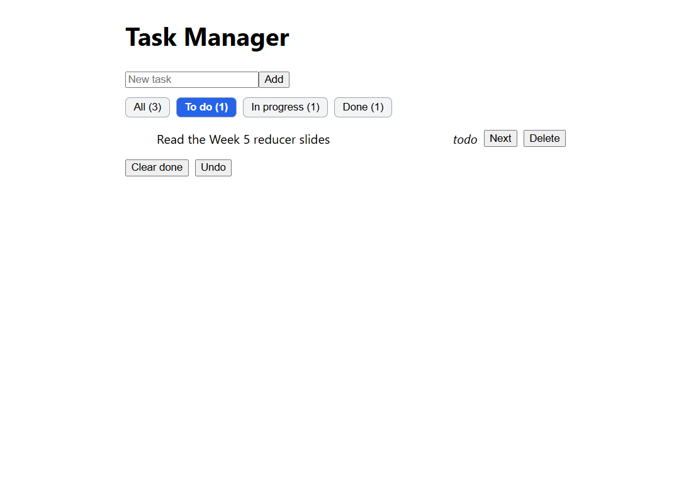
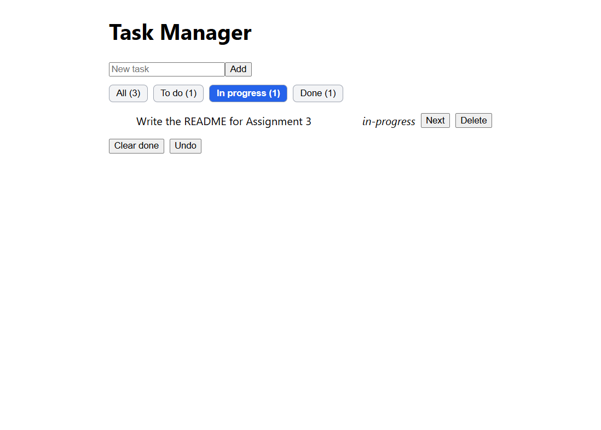
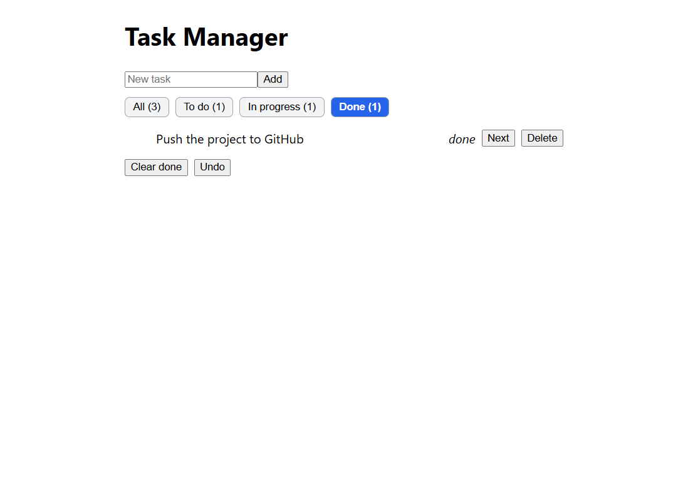

# Assignment 3: Task Manager with a Reducer

**İrem Balkuv** · Student number **2200004679**
SEN0415 Advanced Web Programming, Fall 2026, Week 5

A Vite + React + TypeScript Task Manager. All state lives in `App` in one `useReducer`
and goes down to the components as props (no Context, no state library).

```
npm install
npm run dev      # open the address it prints (http://localhost:5173)
npm run build    # strict type check + production build
npm test         # Vitest (Bonus 2)
```

## What I built (R1 to R7)

| File | What is in it |
|------|---------------|
| `src/taskReducer.ts` | `Status`, `Task`, `State = { tasks, filter, past }`, `initialState`, the `Action` union and `taskReducer` |
| `src/filter.ts` | `Filter`, `FILTERS`, `filterTasks(tasks, filter)`, `countByFilter(tasks)`: pure, no React |
| `src/TaskRow.tsx` | one row: title, status, Next, Delete |
| `src/App.tsx` | `useReducer(taskReducer, initialState)`; `AddForm`, `FilterBar`, `TaskList`, Clear done and Undo get props |

- **Actions:** `add`, `advance`, `remove`, `setFilter`, `clearDone` (and `undo` for Bonus 1).
  The switch ends with a `never` check, so a new action that is not handled is a compile error.
- **Pure reducer:** every branch returns a new object and new arrays/objects for what changed.
  No `Math.random()`, `Date.now()` or `crypto.randomUUID()` inside it; the id comes from `AddForm`.
- **Filter bar:** All / To do / In progress / Done with live counts such as `In progress (1)`.
  The active button is blue and bold (`aria-pressed`). An empty list shows *No tasks here.*
- **Derived, not stored:** `filterTasks(state.tasks, state.filter)` and `countByFilter(state.tasks)`
  are computed in `App` while rendering.
- `npm run build` passes in strict mode and the code uses no `any`.

## Screenshots

Three tasks added; one advanced to *In progress*, one to *Done*; then each filter clicked.

| All | To do |
|-----|-------|
|  |  |
| **In progress** | **Done** |
|  |  |

---

## Bonus 1: Undo

The state is `{ tasks, filter, past }`, where `past: Task[][]` is a stack of earlier task lists
with the newest at the end. Every action that really changes the tasks (`add`, `advance`, `remove`,
`clearDone`) pushes the old `tasks` array onto `past` through one helper, `withTasks`, and
`{ type: 'undo' }` pops the last list back into `tasks`. `setFilter` does not touch `past`, so changing
the filter is not undoable, and actions that change nothing (an unknown id, `clearDone` with nothing
done) do not add an empty undo step. Undo after Clear done brings the cleared tasks back, undo with an
empty `past` returns the same state, and the Undo button is disabled while `past` is empty.

## Bonus 2: Tests

Vitest tests in `src/taskReducer.test.ts` and `src/filter.test.ts` (29 tests):

- every action, and `advance` three times returning to `todo`
- the old state is not changed: the input state is deep-frozen with `Object.freeze` and compared with
  a `structuredClone` copy after every action; new objects are returned for what changed
- `filterTasks` and `countByFilter`
- edge cases: unknown id (advance/remove), empty list, `clearDone` with nothing done, counts after a
  delete and an advance, the three status counts add up to `all`
- undo: nothing to undo, step-by-step undo, undo after `clearDone`, filter changes not recorded

Output of `npm test`:

```
> task-manager-assignment3@0.0.0 test
> vitest run


 RUN  v5.1.0 C:/Users/iremb/Downloads/assignment3

 ✓ src/filter.test.ts (8 tests) 3ms
 ✓ src/taskReducer.test.ts (21 tests) 5ms

 Test Files  2 passed (2)
      Tests  29 passed (29)
   Start at  13:31:14
   Duration  160ms (transform 64%, import 19%, tests 9%, worker 8%)
```

## Bonus 3: Explain your reducer

A reducer has to be pure because React treats state as a value it can compare. After `dispatch`,
React checks whether the new state is a different object from the old one; if I mutated the old
array with `push` and returned it, the reference would be the same and React could skip the re-render,
so the screen would not update. In Strict Mode React also calls the reducer twice in development, so
a reducer that changes things outside itself, or mutates its input, would add a task twice or give
different results. Purity also keeps things like Undo possible: the old `tasks` arrays in `past` stay
valid because nobody changes them.

The caller creates the id with `crypto.randomUUID()` because generating a random value is a side
effect. If the reducer did it, the same state and action would give a different result every time,
and the double call in Strict Mode would produce two different ids for one task. Tests would also be
harder because the output could not be predicted.

The filtered list and the counts are derived because they can always be computed from `tasks` and
`filter`. If I stored `filteredTasks` in state, I would have to remember to update it in every
action. For example, after pressing Next on a task while the filter is *To do*, the stored list would
still show that task, and the counts would go stale after a delete. One source of truth avoids this.

Moving the filter into the reducer made one thing easier: `clearDone` and the filter are handled in
one place and the state is one object, so a single test can check both. It made Undo slightly harder,
because I had to decide that `setFilter` must not create an undo step.

## Bonus 4: Git repository

https://github.com/irembalkuv/assignment3

The history has a separate commit for each step (state shape and new actions, filter functions,
filter bar, undo, tests, README and screenshots). `.gitignore` leaves out `node_modules` and `dist`.
